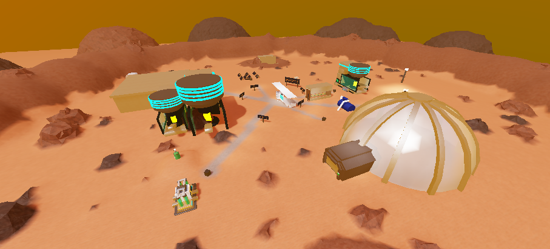

# 🚀 Mars Base 7 — Junior Astronaut Mission Trainer

**Team Project Michaelians Ad Astra** · NASA Space Apps Challenge 2026 · Challenge: *Build a Junior Astronaut Mission Trainer*

Keep a small Mars outpost alive for **7 sols** (Mars days), make **4 rocket fuel**, and fly home.
Each sol your crew shares only **3 power cells** — but **5 stations** need power.
Choosing what to leave unpowered is the lesson.

| | |
|---|---|
| 🎬 **30-second demo** | https://www.youtube.com/watch?v=YOUR_VIDEO_ID |
| 🎮 **Play on Roblox** | https://www.roblox.com/games/YOUR_GAME_ID |
| 📄 **License** | [MIT](LICENSE) |

---

## What is it?

Mars Base 7 is a Roblox game for young learners. Players walk around a Mars outpost as crew members and decide,
sol by sol, which stations get power:

| Station | If powered | If not powered |
|---|---|---|
| ☀️ Solar Panels | +1 power cell next sol | no bonus |
| 🫁 Oxygen Generator | Oxygen +10 | Oxygen −40 |
| 🌱 Greenhouse | Food +15 | Food −30 |
| 🛡️ Shield Bunker | Health +5, door opens in storms | Health −10, door locked |
| ⛽ Rocket Fuel Plant | Fuel +1 (need 4) | no fuel |

Dust storms, solar radiation storms and micrometeorites make every mission different. After each sol a report
shows the **cause → effect** of every choice, and a **"Did you know?"** card links it to a real NASA mission —
Opportunity, MOXIE, Curiosity's RAD instrument, InSight and the Veggie garden on the ISS.

➡️ **Full rules and tips:** [docs/HOW_TO_PLAY.md](docs/HOW_TO_PLAY.md)

---

## ▶️ How to run the game

You need **[Roblox Studio](https://create.roblox.com)** (free, Windows or Mac) and a Roblox account to sign in to Studio.

### Option 1 — Open the ready-made place (fastest)

1. Download this repository: **Code → Download ZIP**, then unzip it.
2. Double-click **`MarsBase7.rbxl`** (or open Roblox Studio → **File → Open from File…** → `MarsBase7.rbxl`).
3. Press **Play** (F5) at the top of Studio.
4. Watch the short tutorial (or press **Skip tutorial**), then press **START MISSION**.

That's it — the map, stations and scripts are already inside the place file.

### Option 2 — Play online

Open the **Play on Roblox** link above and press **Play** (needs the Roblox app and an account).

### Option 3 — Build it from this source code

Use this if you only have the code, or you want to change it.

1. Open your own place (or a new Baseplate) in Roblox Studio and **save** it.
2. **Put the scripts in** — pick one:
   - **Without Rojo:** right-click **Workspace → Insert from File…** → `install/MarsBase7_Scripts.rbxmx`.
     Open **View → Command Bar**, paste all of `install/InstallScripts.lua`, press **Enter**.
   - **With [Rojo](https://rojo.space):** run `rojo serve` in this folder, then in Studio **Plugins → Rojo → Connect**.
3. Build the map: paste `setup/MissionSetup.lua` into the Command Bar → **Enter**, then
   `setup/MapBuilder.lua` → **Enter**. Wait for `DONE` in the **Output** window.
4. **Save** (Ctrl+S) and press **Play**.

> The setup scripts copy the team's handmade models (solar panel, oxygen generator, greenhouse dome, airlock door, refinery).
> In a brand-new place without those models, simple placeholder Power Ports and a placeholder rocket are used.

➡️ **Step-by-step guide and troubleshooting:** [docs/RUNNING.md](docs/RUNNING.md)

### Playing with friends (co-op)

In Studio: **Test → Clients and Servers → 2 Players → Start**. Each player is one crew member; the power cells are shared.

---

## 🧪 For judges and teachers

- **Shorter missions:** type `The Key To Wellness` in chat to open the dev panel → **Mission** tab → **Sol 20s**.
- Trigger any event, set meters, jump to sol 7, or win/lose instantly — see [docs/TESTING.md](docs/TESTING.md).
- A full mission takes about **9 minutes** at the normal 60-second sols.

---

## 📚 Docs

| File | What's inside |
|---|---|
| [HOW_TO_PLAY.md](docs/HOW_TO_PLAY.md) | Rules, stations, events, winning tips (kid-friendly) |
| [RUNNING.md](docs/RUNNING.md) | Detailed setup, every option, troubleshooting |
| [GAME_DESIGN.md](docs/GAME_DESIGN.md) | Design goals, numbers, balance simulation, decisions we made |
| [NASA_SOURCES.md](docs/NASA_SOURCES.md) | Every fact card with its NASA source |
| [TESTING.md](docs/TESTING.md) | Dev panel and a test checklist |
| [CODE_STRUCTURE.md](docs/CODE_STRUCTURE.md) | How the code is organised, where to change things |
| [SANDBOX.md](docs/SANDBOX.md) | The original base-building game this was built from |

---

## 🛠️ Built with

Roblox Studio · Luau · Rojo · Python (balance simulation) · NASA mission data · handmade 3D models — full list of resources in
[docs/NASA_SOURCES.md](docs/NASA_SOURCES.md#tools-and-other-resources).

## 📜 License

Code and docs: [MIT](LICENSE) © 2026 Project Michaelians Ad Astra.
All 3D models (outpost buildings, solar panel, oxygen generator, greenhouse dome, airlock, refinery, workshop props)
were handmade by the team and are covered by the same license.
